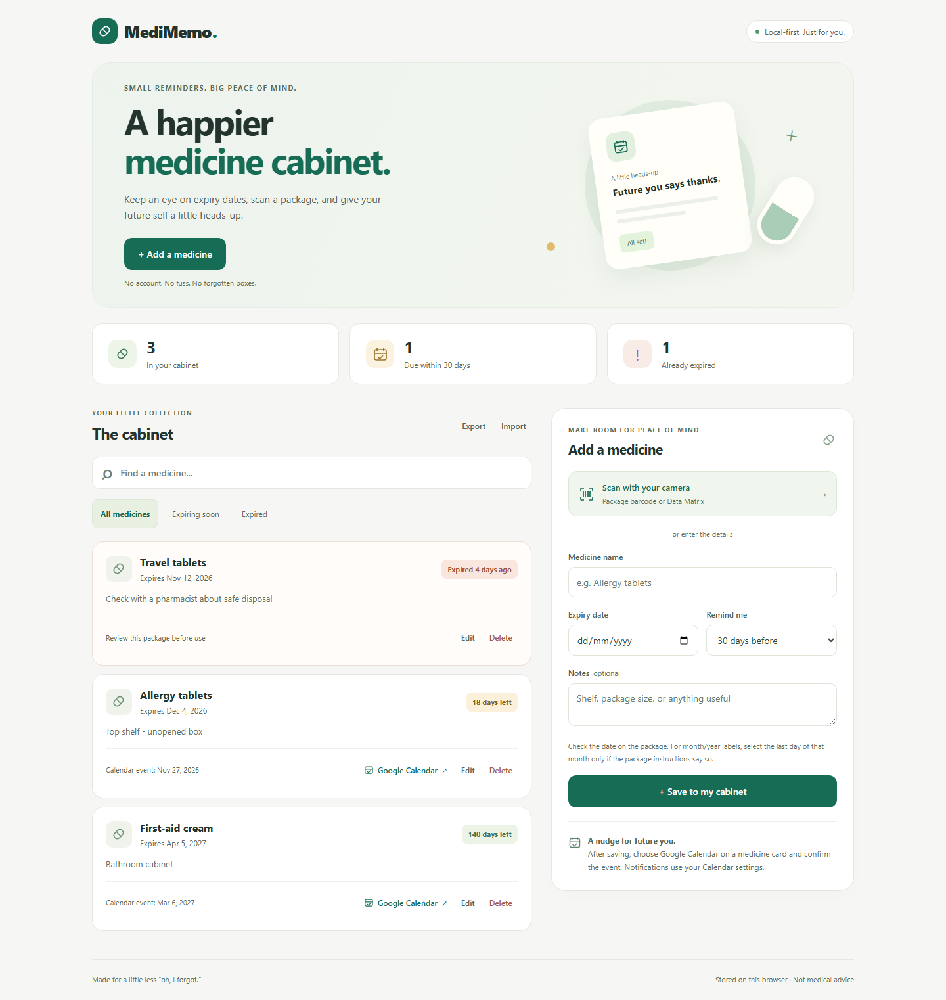

<div align="center">

# MediMemo

### A happier medicine cabinet.

Small reminders. Big peace of mind. A tiny, local-first web app for medicine
expiry dates, camera scanning, and a friendly nudge from Google Calendar.

[Open MediMemo](https://edoardorex.github.io/medimemo/) ·
[Getting started](#run-locally) ·
[How scanning works](#point-scan-double-check)


</div>

---



## A little less "oh, I forgot."

That box at the back of the shelf deserves a little attention, too.
MediMemo keeps things simple: add a medicine, check its expiry, and create a
Calendar event before the date sneaks up on you. No signup, no server, no drama.

| Your cabinet, but calmer | What you get |
| --- | --- |
| **One friendly form** | A name, expiry date, reminder interval, and optional notes |
| **A quick camera scan** | Barcodes and Data Matrix codes, decoded on your device |
| **A heads-up for future you** | A prefilled Google Calendar event 7, 14, 30, or 60 days before expiry |
| **A clear overview** | Expired items, the next 30 days, search, and expiry-first sorting |
| **Your data, your browser** | Local storage, with JSON export and restore |
| **Made for your phone** | Reachable bottom actions, a full-width add/edit sheet, large inputs, and safe-area spacing |

The interface is in English. Dates are displayed using your browser's locale.
No paid services, API keys, or backend configuration are needed.

## Three small steps

1. **Add a medicine.** Type its name and printed expiry date, or scan the package.
2. **Pick your heads-up.** Choose how many days before expiry you want a reminder.
3. **Confirm in Google Calendar.** Click **Google Calendar** on the saved card, review
   the event, set its notification if needed, and save it.

That's it. Future you says thanks.

On a phone, use the bottom bar to jump to your **Cabinet**, **Add medicine**, or
**Scan package**. Adding and editing open a compact sheet; saving brings you
straight back to the saved card. The layout also fits 320px screens, and date
and reminder fields stack when space is tight.
See the [phone-sized form](public/preview-mobile.png).

## Calendar: deliberately simple

MediMemo opens Google's event creation page with an **all-day event** on your
chosen reminder date. If that date has already passed, the event is scheduled
for today. Already-expired medicines do not offer a Calendar link.

**You must save the event in Google Calendar.** MediMemo does not connect to your
account or silently create events. Notification timing and delivery depend on
your Google Calendar notification settings; check them when saving the event.
Opening the link alone does not schedule a notification.

Editing or deleting a medicine here does **not** update or remove an existing
Calendar event. Repeatedly saving the prefilled event can create duplicates.
Medicine names, expiry dates, and notes are included in the Calendar link and
event description: leave sensitive details out of notes if you do not want
them sent to Google.

## Point, scan, double-check

Allow camera access, hold the package steady, and put the whole code inside the
frame. A rear camera is preferred when available; a laptop webcam works too.

- Supported formats: Data Matrix, EAN-13, EAN-8, Code 128, QR, UPC-A, and UPC-E.
- A **GS1 Application Identifier `17`** can provide an expiry date.
  GS1's `YYMM00` form means the last day of that month. This small app interprets
  GS1 two-digit years as 2000–2099; verify any unusually distant date.
- A normal retail barcode usually contains **no expiry date**. MediMemo captures
  the code; you enter the medicine name and printed expiry yourself.
- There is no product database lookup and no OCR of printed text.
  Names are always entered manually. A decoded code is not proof of authenticity.
- Camera frames are processed locally by ZXing. They are not uploaded, saved,
  or added to backups. Closing the scanner releases the camera.

Camera access requires **HTTPS or localhost**, browser support, and permission.
If scanning is unavailable or the code will not read, manual entry always works.

## Run locally

Use **Node.js 22.12+** (or a supported newer release) and npm.

```sh
git clone https://github.com/edoardorex/medimemo.git
cd medimemo
npm ci
npm run dev
```

Open the localhost URL printed by Vite. Use a web server rather than opening
`index.html` directly from disk.

```sh
npm run lint
npm test
npx playwright install chromium
npm run test:e2e
npm run build
npm run preview
```

Unit tests cover date boundaries, GS1 parsing, Calendar links, backup validation,
and storage failures. Browser tests cover the desktop and mobile cabinet,
editing, search, filtering, import/export, accessibility, safe text rendering,
denied camera permission, decoding a generated camera frame, and camera cleanup
when closing and reopening the scanner. Real-camera decoding still depends on
the device and package quality.

## Put it on the web

The live app is published from the **`gh-pages` branch**. In **Settings → Pages**,
the build source is **Deploy from a branch**, with `gh-pages` and `/ (root)`.

**https://edoardorex.github.io/medimemo/**

To update the published app, run `npm ci` and `npm run build -- --base=/medimemo/`,
then publish the **contents** of `dist/` to the `gh-pages` branch. Keep a
`.nojekyll` file at the branch root.

Prefer automatic checks and deployment? Optional workflows are provided in
`examples/workflows/`. Copy them to `.github/workflows/` using a GitHub credential
that can create workflows, and choose **GitHub Actions** as the Pages source
to enable automated deployment on pushes to `main`.

For another static host, build with `npm run build` and publish `dist/`.
For another repository name or a subdirectory, update the `--base` argument and
the links in this README.

## Privacy, in plain English

- Medicine data lives in `localStorage` on the current browser and origin.
  It is **not encrypted**. Anyone using the same browser profile can access it.
- No analytics, tracking scripts, account system, or application backend.
  The app uses system fonts and bundles its scanner dependencies.
- No automatic sync between devices. Export a backup to move your cabinet.
  Backups contain medicine names and notes; keep them private.
- Clearing browser/site data removes your cabinet. Private browsing may discard it.
  Back up before changing devices or clearing storage.
- Broken local data is not silently overwritten. Restore a backup or explicitly
  reset it. Failed writes are reported instead of pretending the change was saved.
- Google receives event details only when you open the Calendar link.
  Your static hosting provider still handles ordinary page requests.

## Tiny by design

```text
src/
  domain.js     Dates, validation, GS1 parsing, Calendar links
  storage.js    Local persistence
  scanner.js    Camera decoding
  main.js       Interface and interactions
  style.css     A little mint-green calm
tests/
  domain.test.js
  e2e/app.spec.js
```

Built with vanilla JavaScript, Vite, and ZXing. No UI framework to babysit.

## A sensible little disclaimer

MediMemo is an organizer, **not medical advice** or a medication schedule.
Always verify the printed expiry and follow the package instructions, including
any shorter shelf life after opening. For month/year-only labels, follow the
manufacturer's instructions rather than guessing a day. A green badge only means
the entered expiry is more than 30 days away; it is not a safety assessment.
Ask a pharmacist about use, storage, or safe disposal when unsure.

## License

MIT. Make it yours, keep it kind, and give future you a little peace of mind.
